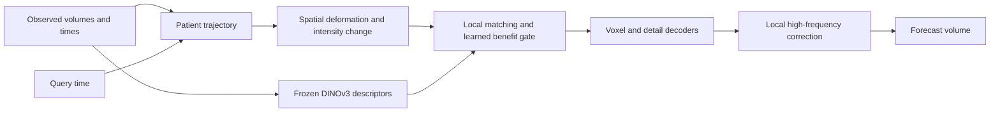
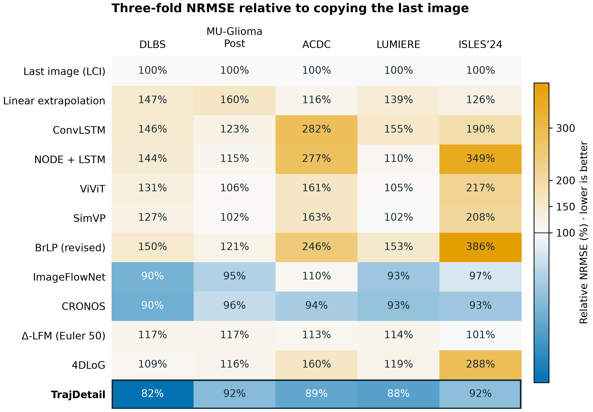
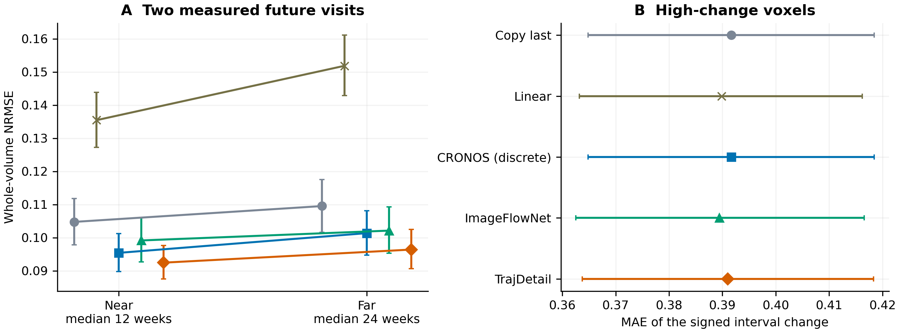
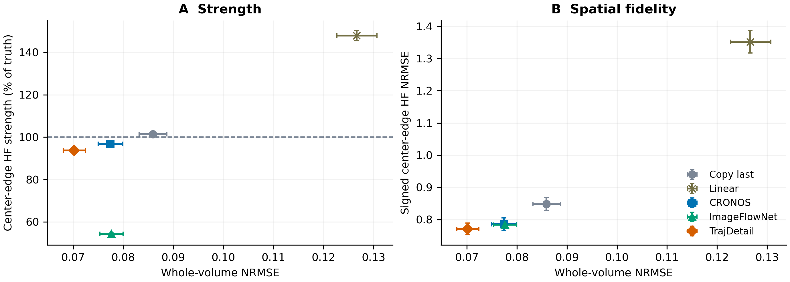
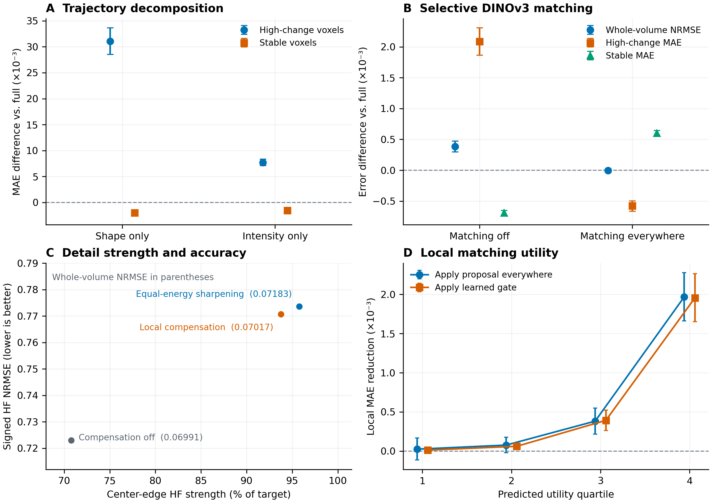
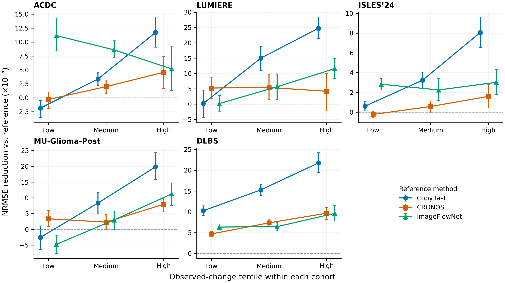

# TrajDetail

TrajDetail forecasts a full 3D medical image at a requested future acquisition time. It uses only the observed images, their timestamps, and the requested timestamp during inference. The benchmark covers patient follow-up MRI, cardiac cine MRI, and perfusion CT.



The trajectory assimilates available observations and rolls a shared state forward. A velocity field moves spatial structure while a source term changes intensity. Local feature matches propose additional geometric corrections. The benefit gate is trained on paired errors with and without the proposed correction, then estimates the gain from observed images at inference. The two decoder branches produce a voxel forecast and a detail forecast. The final step computes a bounded correction along the predicted local high-frequency direction on a support region derived from the model outputs.

The TrajDetail implementation is in [methods/trajdetail](methods/trajdetail), with the primary components in [unified_model.py](methods/trajdetail/unified_model.py), [matched_control.py](methods/trajdetail/matched_control.py), and [proposed.py](methods/trajdetail/proposed.py). The shared decoders are jointly trained across ACDC, LUMIERE, and ISLES’24, and a separate instance is jointly trained across MU-Glioma-Post and DLBS. The two groups use the same model design. Tests always report each cohort on its own.

## Benchmark and results

### Five-cohort comparison

**Three-fold test NRMSE (mean ± SD, lower is better).** TrajDetail has the lowest observed mean in all five cohorts. Bold values mark the lowest mean per cohort.

| Method | DLBS | MU-Glioma-Post | ACDC | LUMIERE | ISLES’24 |
| :--- | ---: | ---: | ---: | ---: | ---: |
| Last image (LCI) | 0.08590 ± 0.00123 | 0.10002 ± 0.00563 | 0.03934 ± 0.00399 | 0.10943 ± 0.01043 | 0.04930 ± 0.00327 |
| Linear extrapolation | 0.12664 ± 0.00046 | 0.16038 ± 0.00722 | 0.04559 ± 0.00674 | 0.15169 ± 0.01189 | 0.06213 ± 0.00293 |
| ConvLSTM | 0.12510 ± 0.00344 | 0.12267 ± 0.00859 | 0.11107 ± 0.00301 | 0.16982 ± 0.00402 | 0.09357 ± 0.00217 |
| NODE + LSTM | 0.12390 ± 0.00189 | 0.11529 ± 0.00434 | 0.10901 ± 0.00318 | 0.12035 ± 0.00348 | 0.17190 ± 0.00254 |
| ViViT | 0.11286 ± 0.00149 | 0.10603 ± 0.00426 | 0.06339 ± 0.00227 | 0.11527 ± 0.00296 | 0.10721 ± 0.00116 |
| SimVP | 0.10889 ± 0.00052 | 0.10229 ± 0.00483 | 0.06395 ± 0.00404 | 0.11164 ± 0.00330 | 0.10233 ± 0.00096 |
| BrLP (revised) | 0.12850 ± 0.00481 | 0.12143 ± 0.00282 | 0.09697 ± 0.00628 | 0.16730 ± 0.02777 | 0.19046 ± 0.00526 |
| ImageFlowNet | 0.07762 ± 0.00148 | 0.09465 ± 0.00546 | 0.04324 ± 0.00168 | 0.10205 ± 0.00714 | 0.04806 ± 0.00296 |
| CRONOS | 0.07738 ± 0.00229 | 0.09607 ± 0.00494 | 0.03702 ± 0.00272 | 0.10137 ± 0.00638 | 0.04600 ± 0.00256 |
| Δ-LFM (Euler 50) | 0.10088 ± 0.00194 | 0.11680 ± 0.00784 | 0.04453 ± 0.00362 | 0.12497 ± 0.00396 | 0.04998 ± 0.00310 |
| 4DLoG | 0.09380 ± 0.00263 | 0.11645 ± 0.00301 | 0.06314 ± 0.00306 | 0.12985 ± 0.00349 | 0.14184 ± 0.00809 |
| **TrajDetail** | **0.07017 ± 0.00179** | **0.09158 ± 0.00528** | **0.03493 ± 0.00210** | **0.09637 ± 0.00697** | **0.04535 ± 0.00267** |



[Download vector PDF](results/reference/figures/benchmark_relative_nrmse.pdf)

[Full-precision benchmark CSV](results/reference/nrmse_3fold.csv)

<details>
<summary>Cohort sizes, forecast targets, and evaluation protocol</summary>

| Validation entry point | Dataset and forecast | Total held-out subjects |
| --- | --- | ---: |
| `validate_acdc.py` | ACDC cardiac cine MRI, future phase | 150 |
| `validate_lumiere.py` | LUMIERE longitudinal brain MRI, future visit | 67 |
| `validate_isles.py` | ISLES’24 dynamic perfusion CT, future phase | 149 |
| `validate_mu.py` | MU-Glioma-Post contrast-enhanced MRI, future visit | 110 |
| `validate_dlbs.py` | Dallas Lifespan Brain Study structural MRI, future visit | 179 |

The frozen manifests in [configs/splits](configs/splits) specify patients, observed windows, and query times. Each patient appears in exactly one held-out fold. Validation patients are distinct from training and held-out patients within each fold. Model selection uses validation data. All methods have the same available past observations and test query. A method that takes a single starting scan uses the latest observation. Methods designed for two inputs take the latest two and repeat the first when only one exists. ACDC and ISLES use normalized examination time, LUMIERE uses acquisition weeks, and MU/DLBS use acquisition days converted to the model's time scale. The headline metric is the patient-level RMSE on the shared intensity-normalized grid, called NRMSE in the benchmark. It is reported in unit intensity range. The main comparison reports the arithmetic mean and sample SD of the three held-out fold means.

ConvLSTM, SimVP, NODE + LSTM, and ViViT are architecture adaptations for the common input. CRONOS uses the original discrete architecture on ACDC, LUMIERE, and ISLES’24 and the shared continuous implementation on MU-Glioma-Post and DLBS. The BrLP row uses ten latent samples, 25 DDIM steps, and a decoder selected on validation. Δ-LFM uses 50 Euler steps.

</details>

### LUMIERE · forecasts at two follow-up visits

All 67 held-out subjects use the same observed history for the two queries. Change is the later volume minus the earlier volume. The high-change region is the top quartile of absolute observed change among foreground voxels.

| Method | Near NRMSE ↓ | Far NRMSE ↓ | Change MAE ↓ | High-change MAE ↓ | High-change sign accuracy ↑ |
| :--- | ---: | ---: | ---: | ---: | ---: |
| Last image (LCI) | 0.10477 | 0.10955 | 0.15686 | 0.39167 | 0.0% |
| Linear extrapolation | 0.13547 | 0.15186 | 0.16550 | 0.38984 | 24.2% |
| CRONOS | 0.09543 | 0.10138 | 0.15686 | 0.39167 | 0.0% |
| ImageFlowNet | 0.09917 | 0.10214 | 0.16225 | 0.38941 | 52.1% |
| **TrajDetail** | 0.09247 | 0.09642 | 0.16043 | 0.39098 | 50.9% |

The far-visit NRMSE difference from CRONOS is −0.00496 (95% CI [−0.00779, −0.00211]). The high-change MAE difference from ImageFlowNet is +0.00157 (95% CI [−0.00126, +0.00449]). The evaluated discrete CRONOS configuration returns the same volume at both query times. [Full results and paired intervals CSV](results/reference/lumiere_two_query_comparison.csv)



[Download vector PDF](results/reference/figures/lumiere_external_trajectory.pdf)

### DLBS · high-frequency detail

All 179 held-out subjects are included. High-frequency (HF) strength is the ratio of predicted to observed high-frequency strength at central edges. Signed HF NRMSE measures voxelwise agreement of the signed filter response.

| Method | NRMSE ↓ | HF strength → 100% | Signed HF NRMSE ↓ |
| :--- | ---: | ---: | ---: |
| Last image (LCI) | 0.08591 | 101.4% | 0.84817 |
| Linear extrapolation | 0.12664 | 147.9% | 1.35163 |
| CRONOS | 0.07739 | 96.8% | 0.78550 |
| ImageFlowNet | 0.07763 | 54.3% | 0.78430 |
| **TrajDetail** | 0.07017 | 93.8% | 0.77074 |

TrajDetail retains 93.8% of target HF strength. The signed HF NRMSE difference from CRONOS is −0.01475 (95% CI [−0.02022, −0.00928]). [Full results and paired intervals CSV](results/reference/dlbs_detail_comparison.csv)



[Download vector PDF](results/reference/figures/dlbs_external_detail.pdf)

### DLBS · component interventions

Each fold reuses its trained checkpoint. Interventions change one computation at inference while keeping the decoder fixed. High-change and stable regions are the upper and lower quartiles of observed foreground change. These auxiliary analyses report patient-level means. The paired 95% intervals use a bootstrap stratified by fold.

| Component | Setting | NRMSE ↓ | High-change MAE ↓ | Stable MAE ↓ | HF strength → 100% | Signed HF NRMSE ↓ |
| :--- | :--- | ---: | ---: | ---: | ---: | ---: |
| Trajectory | Intensity only | 0.07220 | 0.16242 | 0.03307 | 93.5% | 0.77058 |
| Trajectory | **Deformation and intensity** | 0.07017 | 0.15471 | 0.03464 | 93.8% | 0.77074 |
| Trajectory | Deformation only | 0.07855 | 0.18575 | 0.03263 | 94.3% | 0.78946 |
| Local matching | Matching always on | 0.07017 | 0.15413 | 0.03524 | 93.4% | 0.76953 |
| Local matching | **Learned benefit gate** | 0.07017 | 0.15471 | 0.03464 | 93.8% | 0.77074 |
| Local matching | Matching off | 0.07056 | 0.15679 | 0.03394 | 89.3% | 0.75825 |
| Detail correction | **Local compensation** | 0.07017 | 0.15471 | 0.03464 | 93.8% | 0.77074 |
| Detail correction | Compensation off | 0.06991 | 0.15343 | 0.03496 | 70.8% | 0.72301 |
| Detail correction | Uniform sharpening | 0.07183 | 0.15696 | 0.03786 | 95.8% | 0.77362 |

The learned gate reduces NRMSE relative to turning matching off and reduces stable-region MAE relative to keeping matching always on. Local compensation raises HF strength from 70.8% to 93.8% and increases whole-volume NRMSE by 0.00027 relative to turning compensation off. It has lower whole-volume and signed HF error than energy-matched uniform sharpening. [All intervention estimates and paired intervals CSV](results/reference/dlbs_mechanism_analysis.csv)



[Download vector PDF](results/reference/figures/dlbs_mechanism.pdf)

<details>
<summary>Intermediate output scores and matching gate quartiles</summary>

| Component | Setting | NRMSE ↓ | High-change MAE ↓ | Stable MAE ↓ | HF strength → 100% | Signed HF NRMSE ↓ |
| :--- | :--- | ---: | ---: | ---: | ---: | ---: |
| Trajectory output | Intensity only | 0.07724 | 0.18147 | 0.03041 | 100.7% | 0.84304 |
| Trajectory output | Last image (LCI) | 0.08591 | 0.22351 | 0.01427 | 101.4% | 0.84817 |
| Trajectory output | **Deformation and intensity** | 0.07266 | 0.16517 | 0.03215 | 79.9% | 0.75923 |
| Trajectory output | Deformation only | 0.08201 | 0.20242 | 0.02322 | 80.5% | 0.76421 |
| Matching output | Matching always on | 0.07170 | 0.16089 | 0.03391 | 72.0% | 0.74051 |
| Matching output | **Learned benefit gate** | 0.07180 | 0.16178 | 0.03301 | 74.0% | 0.74366 |
| Matching output | Matching off | 0.07266 | 0.16517 | 0.03215 | 79.9% | 0.75923 |

Eligible voxels are grouped by predicted utility. Positive mean MAE gains indicate error reduction.

| Utility quartile | Mean gate | Proposal MAE gain | Applied MAE gain | Proposal win rate |
| :--- | ---: | ---: | ---: | ---: |
| 1 | 0.02621 | 0.0000246 | 0.0000129 | 49.5% |
| 2 | 0.19146 | 0.0000766 | 0.0000612 | 50.0% |
| 3 | 0.63259 | 0.0003825 | 0.0003923 | 50.6% |
| 4 | 0.98605 | 0.0019681 | 0.0019555 | 53.0% |

[Gate estimates and bootstrap intervals CSV](results/reference/dlbs_gate_analysis.csv)

</details>

### Five cohorts · results by observed change

Each cohort is divided into thirds by the last-image baseline’s error against the measured future scan. This retrospective grouping is used only for evaluation. Positive NRMSE gains mean lower error for TrajDetail.



[Download vector PDF](results/reference/figures/cohort_change_strata.pdf)

<details>
<summary>Show means and paired 95% intervals for all change strata</summary>

| Cohort | Change | Subjects | TrajDetail NRMSE ↓ | Gain vs. LCI | Gain vs. CRONOS | Gain vs. ImageFlowNet |
| :--- | :--- | ---: | ---: | ---: | ---: | ---: |
| DLBS | All | 179 | 0.07017 | +0.01573 [+0.01456, +0.01694] | +0.00722 [+0.00656, +0.00789] | +0.00745 [+0.00669, +0.00826] |
| DLBS | Low | 60 | 0.05662 | +0.01026 [+0.00915, +0.01142] | +0.00468 [+0.00413, +0.00525] | +0.00634 [+0.00562, +0.00707] |
| DLBS | Medium | 60 | 0.06869 | +0.01528 [+0.01394, +0.01655] | +0.00735 [+0.00639, +0.00825] | +0.00643 [+0.00545, +0.00740] |
| DLBS | High | 59 | 0.08547 | +0.02176 [+0.01940, +0.02418] | +0.00966 [+0.00820, +0.01105] | +0.00962 [+0.00779, +0.01154] |
| MU-Glioma-Post | All | 110 | 0.09152 | +0.00843 [+0.00549, +0.01132] | +0.00449 [+0.00291, +0.00604] | +0.00307 [+0.00076, +0.00537] |
| MU-Glioma-Post | Low | 37 | 0.06577 | −0.00259 [−0.00642, +0.00106] | +0.00334 [+0.00089, +0.00591] | −0.00478 [−0.00767, −0.00189] |
| MU-Glioma-Post | Medium | 37 | 0.08734 | +0.00834 [+0.00481, +0.01168] | +0.00228 [−0.00005, +0.00468] | +0.00297 [−0.00010, +0.00587] |
| MU-Glioma-Post | High | 36 | 0.12229 | +0.01985 [+0.01582, +0.02430] | +0.00795 [+0.00552, +0.01029] | +0.01124 [+0.00764, +0.01475] |
| ACDC | All | 150 | 0.03493 | +0.00442 [+0.00304, +0.00584] | +0.00210 [+0.00092, +0.00330] | +0.00832 [+0.00656, +0.01016] |
| ACDC | Low | 50 | 0.02314 | −0.00186 [−0.00356, −0.00047] | −0.00029 [−0.00190, +0.00104] | +0.01117 [+0.00842, +0.01431] |
| ACDC | Medium | 50 | 0.03032 | +0.00337 [+0.00221, +0.00449] | +0.00201 [+0.00081, +0.00318] | +0.00860 [+0.00718, +0.01025] |
| ACDC | High | 50 | 0.05132 | +0.01174 [+0.00909, +0.01449] | +0.00458 [+0.00168, +0.00744] | +0.00518 [+0.00128, +0.00928] |
| LUMIERE | All | 67 | 0.09642 | +0.01313 [+0.00970, +0.01645] | +0.00496 [+0.00211, +0.00779] | +0.00572 [+0.00339, +0.00801] |
| LUMIERE | Low | 23 | 0.07481 | +0.00019 [−0.00443, +0.00458] | +0.00524 [+0.00193, +0.00880] | +0.00018 [−0.00253, +0.00285] |
| LUMIERE | Medium | 22 | 0.09229 | +0.01500 [+0.01088, +0.01876] | +0.00543 [+0.00152, +0.00966] | +0.00565 [+0.00147, +0.00958] |
| LUMIERE | High | 22 | 0.12315 | +0.02478 [+0.02137, +0.02842] | +0.00419 [−0.00227, +0.01004] | +0.01158 [+0.00839, +0.01497] |
| ISLES’24 | All | 149 | 0.04534 | +0.00394 [+0.00318, +0.00476] | +0.00065 [+0.00019, +0.00113] | +0.00270 [+0.00212, +0.00331] |
| ISLES’24 | Low | 50 | 0.02711 | +0.00061 [+0.00013, +0.00107] | −0.00022 [−0.00055, +0.00010] | +0.00284 [+0.00226, +0.00343] |
| ISLES’24 | Medium | 50 | 0.04134 | +0.00324 [+0.00240, +0.00407] | +0.00058 [+0.00001, +0.00114] | +0.00225 [+0.00121, +0.00341] |
| ISLES’24 | High | 49 | 0.06801 | +0.00806 [+0.00655, +0.00962] | +0.00160 [+0.00043, +0.00283] | +0.00302 [+0.00178, +0.00430] |

[Full stratified results, including paired win counts](results/reference/cohort_analysis.csv)

</details>

### BrLP adaptation update

<details>
<summary>Show original and revised BrLP results</summary>

| Cohort | Subjects | Original NRMSE ↓ | Revised NRMSE ↓ |
| :--- | ---: | ---: | ---: |
| ACDC | 150 | 0.13526 ± 0.00703 | 0.09697 ± 0.00628 |
| LUMIERE | 67 | 0.37447 ± 0.11559 | 0.16730 ± 0.02777 |
| ISLES’24 | 149 | 0.28120 ± 0.03161 | 0.19046 ± 0.00526 |
| MU-Glioma-Post | 110 | 0.26411 ± 0.04048 | 0.12143 ± 0.00282 |
| DLBS | 179 | 0.23823 ± 0.01139 | 0.12850 ± 0.00481 |

The main comparison uses the revised scores. [Full-precision BrLP adaptation CSV](results/reference/brlp_repair_nrmse.csv)

</details>

## Layout

```text
TrajDetail/
├── train.py
├── validate_{acdc,lumiere,isles,mu,dlbs}.py
├── README.md
├── .gitignore
├── methods/<method>/                   # model or author-code adapter
│   └── weight/<training-group>/foldN/<run>/
├── src/                                # data, preprocessing, metrics, orchestration
├── configs/<training-group>/<method>.json
├── sh/<training-group>_<method>.sh
└── results/
    ├── reference/                      # previously recorded benchmark results
    └── <dataset>/<run>/foldN/test/      # newly evaluated cases, figures, and summaries
```

## Environment and data

Use Python 3.11 and matching builds of PyTorch and torchvision. The local GPU checks used Python 3.11 and PyTorch 2.11.0 with CUDA 12.8. Install a build suited to the machine from the PyTorch installation instructions, then run the following from the repository.

```bash
python -m pip install -r configs/requirements.txt
python -m pip install -r configs/requirements-comparators.txt
export TRAJDETAIL_DATA=/path/to/TrajDetail_data
```

Acquire each dataset through its distribution terms. Store the prepared volumes outside the repository at `TRAJDETAIL_DATA` (default `../TrajDetail_data`). These are the five input layouts.

| Dataset | Expected prepared files | Preparation |
| --- | --- | --- |
| ACDC | `source_cache/acdc/{trn,val,tst}_dat.npy` | Run `python -m src.prepare_acdc --dataset-root /path/to/acdc/database --output-dir "$TRAJDETAIL_DATA/source_cache/acdc" --manifest /tmp/acdc_manifest.json` on the original cine scans and phase metadata. Use both original ACDC training and testing directories. The writer also produces auxiliary arrays used by the historical preprocessing. |
| LUMIERE | `source_cache/lumiere/manifest.json` and one time-series NPY per patient | Run `python -m src.prepare_lumiere --raw-root /path/to/LUMIERE/Imaging` on the v202211 registered skull-stripped T1 volumes. The script matches the frozen visit list and verifies each normalized array. With the original prepared NPY files and matching patient manifest, use `python -m src.prepare_benchmark lumiere --source /path/to/lumiere_protocol`. |
| ISLES’24 | `source_cache/isles/<subject>.npy` | Run `python -m src.prepare_isles --raw-root /path/to/ctp --output "$TRAJDETAIL_DATA/isles_protocol" --workers 8`, then `python -m src.prepare_benchmark isles --source "$TRAJDETAIL_DATA/isles_protocol"`. This converts the CTP volumes into the common time-volume grid and applies the benchmark's loader normalization. |
| MU-Glioma-Post | `longitudinal/mu/<patient>.npy` | Run `python -m src.prepare_benchmark mu --source /path/to/MU-Glioma-Post`. The upstream download layout contains the contrast-enhanced NIfTI series and the clinical spreadsheet under `metadata/`, together with the file inventory `metadata/download_manifest.json`. |
| DLBS | `longitudinal/dlbs/<participant>.npy` | Run `python -m src.prepare_benchmark dlbs --source /path/to/ds004856` on the OpenNeuro BIDS tree with `participants.tsv` and the structural images identified in `configs/protocol/dlbs_T1_inventory.json`. |

`python -m src.prepare_benchmark acdc --check` checks all stored windows against the release protocol. Substitute any dataset identifier above to check the corresponding data.

Install author code separately under its license with `python -m src.setup_upstream <method> /path/to/checkout`. Supported method identifiers are `cronos` (MIC-DKFZ/Longitudinal4DMed), `imageflownet` (KrishnaswamyLab/ImageFlowNet), `log4d` (vfb8zv/4DLoG), `brlp` (LemuelPuglisi/BrLP), `delta_lfm` (chqwer2/Disease-Progression-World-Model, directory `ICLR 2026 Delta-LFM`), and `trajdetail` (facebookresearch/dinov3). Use the source revisions in [configs/protocol/upstream.json](configs/protocol/upstream.json) where a revision was available. BrLP uses `monai-generative==0.2.3` alongside the pinned MONAI 1.x release. Δ-LFM retraining needs the author's `autoencoder_epoch273.pt` at `$TRAJDETAIL_DATA/delta_lfm/`. TrajDetail needs DINOv3 ViT-B/16 weights at `$TRAJDETAIL_DATA/dinov3_vitb16_pretrain_lvd1689m-73cec8be.pth` or at the path specified by `TRAJDETAIL_DINO_WEIGHTS`.

### Local archive setup

The existing research server can register its prepared data and selected checkpoints with symlinks. This uses the local benchmark archive and keeps large files at their existing locations. Run from `/workspace/TrajDetail`.

```bash
export TRAJDETAIL_DATA=/mnt/Users/LiangJiaming/TrajDetail_data
python -B -m src.import_local --source /workspace/Generation --only assets \
  --datasets /mnt/Datasets \
  --raw-cache /dev/shm/generation_new_longitudinal_20261121 \
  --source-cache /tmp/generation_3fold_source_20261122 \
  --dino /tmp/dinov3 \
  --dino-weights /mnt/Users/LiangJiaming/SomeKeeper/SPkeeper/DinoV3/dinov3_vitb16_pretrain_lvd1689m-73cec8be.pth
python -B -m src.import_local --source /workspace/Generation --only weights
```

## Train and evaluate

This quick check trains ConvLSTM for one epoch on the first ACDC fold, then evaluates all 50 of its held-out patients and writes a matched-case figure. Use a free CUDA device index or set `--device cpu` for the quick check.

```bash
python -B train.py --config configs/acdc/convlstm_smoke.json --fold 1 --device cuda:0 --run smoke
python -B validate_acdc.py --method copy convlstm --fold 1 --device cuda:0 --run smoke
```

Train with the full configurations using the same entry point. There is one shell launcher per experiment configuration. The launchers distribute independent cross-validation folds over the supplied GPUs, with one process per GPU and one fixed split per process.

```bash
GPUS=0,1,2 RUN_NAME=retrain bash sh/legacy_trajdetail.sh
GPUS=0,1,2 RUN_NAME=retrain bash sh/mu-dlbs_trajdetail.sh
python -B validate_acdc.py --method trajdetail --fold 1 2 3 --run retrain --device cuda:0
python -B validate_dlbs.py --method trajdetail --fold 1 2 3 --run retrain --device cuda:0
```

A config specifies the method, training group, and training hyperparameters. Duplicate an existing config and use a new `--run` name to vary its hyperparameters. Training writes checkpoints into `methods/<method>/weight/<group>/foldN/<run>/`. The completion manifest records the selected checkpoint paths, file sizes, and hashes of the fold manifests. Classical trainable baselines also verify the selected epoch against the validation history. Each evaluation entry point finds the corresponding group and run automatically, checks the completion record, and loads the validation-selected weights. Persistence and linear extrapolation require no fitted parameters.

The evaluation command defaults to all methods and all three folds. `--method` and `--fold` accept multiple values. `--limit` previews a fixed prefix of held-out patients under a separate output path. `--save-predictions` writes volumes for subsequent measurement. Outputs include a CSV for each method, the across-method fold table, a shared grayscale prediction and absolute-error figure, and a three-fold summary when all folds are scored without a preview limit. Each method uses the same figure case and color scales.

## Attribution and distribution

Reference experiments use the dataset providers' agreements and the original authors' software and weight terms. The local repository keeps downloaded data, author code installations, checkpoints, and individual generated images out of version control by default. The manuscript methods, aggregate tables and reproduction scripts are organized here for release.

### Verification record

The documented ACDC quick check completed on the local server. The evaluator loaded the newly selected ConvLSTM checkpoint and wrote metrics for all 50 held-out patients plus a case figure. All 12 checkpoint or reference paths also ran on a common ACDC preview case. The TrajDetail checkpoints were rerun on all 655 patients in the five sets of held-out folds and reproduced the [five aggregate NRMSE values](results/reference/trajdetail_revalidation.csv). Both TrajDetail training groups completed all stages from initialization in small GPU checks with shortened schedules and one training and one validation subject per cohort. The reported benchmark scores come from the full archive checkpoints.
